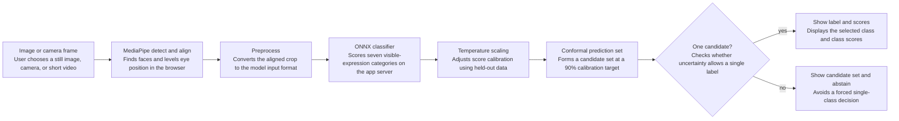

# AffectLens

**A facial expression research demo that reports uncertainty and can abstain.**

## Demo

Live demo: [affectlens-c9kc.onrender.com](https://affectlens-c9kc.onrender.com) · Source: [github.com/snehamanjunatharaju/affectlens](https://github.com/snehamanjunatharaju/affectlens). Run locally at <http://127.0.0.1:8000>.

## Demo GIF

The browser flow supports image upload and opt-in live camera analysis. A recorded demo GIF is not included yet; no user camera footage is used in this repository.

## Architecture



## Results

The first two test columns use the same **4,078-image held-out split** from the FER training partition; the next columns report the separately supplied **3,589-image FER-2013 PublicTest split**. The compact hard-label and soft-label runs use the full training split. EfficientNet-B0 is only a 1,000-image, four-epoch feasibility pilot; it is not a full-data comparison. Full per-class precision/recall/F1, confusion matrices, reliability bins, and risk-coverage data are in [`reports/model-comparison.json`](reports/model-comparison.json).

An earlier experimental image-plus-mesh fusion reached **61.48% accuracy / 48.77% macro-F1** on a held-out FER+ split with its then-current image model. It is not the active AffectNet model. See [`reports/ferplus-multimodal-fusion.json`](reports/ferplus-multimodal-fusion.json) for the historical results.

| Model | Internal holdout acc / F1 | PublicTest acc / F1 | PublicTest ECE | PublicTest coverage | Mean set size | Training note |
|---|---:|---:|---:|---:|---:|---|
| Compact, hard labels, light augmentation | 35.85% / 30.97% | 31.79% / 29.00% | 0.041 | 83.14% | 4.45 / 7 | Reference run |
| Compact, hard labels, no augmentation | 41.59% / 33.27% | 34.86% / 30.33% | 0.060 | 81.89% | 3.88 / 7 | Same split, seed, and epoch budget |
| Compact, FER+ soft labels | **44.14% / 36.51%** | **39.54% / 34.93%** | 0.038 | 83.17% | 4.20 / 7 | Previous checkpoint; 10-rater distributions |
| ImageNet EfficientNet-B0 | 25.13% / 20.94% | 25.94% / 23.13% | **0.012** | 88.55% | 5.44 / 7 | 1,000 examples, four epochs, 48×48 pilot |

Reliability plot: [`docs/reliability.png`](docs/reliability.png). Controlled corruption report and chart: [`reports/ferplus-publictest-robustness.json`](reports/ferplus-publictest-robustness.json) and [`docs/robustness.png`](docs/robustness.png). Error examples with Grad-CAM overlays: [`docs/FAILURE_ANALYSIS.md`](docs/FAILURE_ANALYSIS.md).

The table above records the earlier CompactFER runs. Their temperature and conformal thresholds were fit on separate calibration data; the older model achieved only 83.17% PublicTest coverage against a nominal 90% target. The AffectNet model now uses its own validation-fitted temperature and conformal threshold, detailed in the model card. In this run, removing augmentation improved the compact hard-label model; augmentation is not assumed to help without an ablation.

On synthetic PublicTest shifts, the biggest accuracy drops were eye-band occlusion (21.01%), 45° rotation (22.51%), dim lighting (23.07%), and added noise (24.71%), versus 39.54% clean. Occlusion and noise also raised ECE to 0.225 and 0.174, and conformal coverage fell to 71.05% and 70.10%. These are controlled image edits, not a substitute for collecting authorized real-world test data.

## Limitations

- FER-2013 is low-resolution and noisy. FER+ improves its labels but does not add new photographs.
- Evaluation is image-level, not identity-disjoint, and uses a single held-out split.
- AffectNet-to-FER+ transfer was evaluated using the supplied FER+ splits. No in-domain AffectNet test set or RAF-DB evaluation was available; model results therefore do not establish performance on either dataset's broader population.
- Subgroup fairness analysis is **not run**: the available data has no suitable demographic annotations. Do not infer fairness from aggregate scores.
- The EfficientNet-B0 result is a compute-limited pilot, not evidence that a pretrained backbone is worse when properly trained on a larger licensed dataset.
- Expression classes describe visible patterns; they do not establish internal feelings, intent, personality, or wellbeing. This demo is unsuitable for decisions about people.

See the [model card](docs/MODEL_CARD.md) and [fairness status](docs/FAIRNESS.md) for intended use, risks, and the exact scope of the available data.

The label-quality audit ranks potential FER+ label issues with out-of-fold Cleanlab scores and compares original-label training with capped candidate filtering; see [`docs/LABEL_QUALITY.md`](docs/LABEL_QUALITY.md) for its method and caveats.

### Evaluate image and face-mesh fusion

The optional fusion trainer learns a small late-fusion head from held-out FER+ image-model scores and MediaPipe's 52 blendshape coefficients. It reproduces the browser's aligned crop, reserves separate fit, selection, and calibration portions of `validation/`, evaluates once on `test/`, and only writes the active `.fusion.onnx` sidecar when the selection split improves macro-F1 by at least one point without reducing accuracy materially. Otherwise, it saves a candidate that the API will not load. The live UI sends blendshape coefficients locally, marks image/mesh disagreements uncertain, and shows a recent-frame trend separately from calibrated frame scores.

```bash
python -m pip install -e '.[fusion]'
python -m affectlens.train_fusion --data data/fer-2013-ferplus --model artifacts/fer-ferplus.onnx --output artifacts/fer-ferplus
```

This dataset contains labeled still images, not labeled expression sequences. The fusion head therefore learns static image and mesh cues; it does not learn a temporal emotion model. The live trend is descriptive smoothing, not a validated temporal classifier. Results remain specific to the FER+ data distribution and do not establish a person's internal emotional state or guarantee performance on stock photos or webcam footage.

AffectLens brings the FER-2013 seven-class task into one clean project, replacing machine-specific paths and training-on-import scripts with a reproducible trainer, a local API, and a browser interface. Its focus is **selective prediction**: a split-conformal calibration set can return a set of plausible classes or abstain when it cannot make a single-label prediction.

## What works in this foundation

- FastAPI service with a single-image analysis endpoint and a health endpoint.
- Browser interface with image upload, opt-in live camera, up to three detected faces, and local video timeline sampling.
- Browser-local MediaPipe Face Landmarker detects faces and levels the eye line; the aligned crop is sent to the app server for classification.
- When the validated fusion sidecar is loaded, MediaPipe blendshape coefficients are combined with image-model scores; disagreements force an uncertain result. Blendshapes are not emotion labels by themselves.
- ONNX Runtime CPU inference, so a trained/exported model can run without a heavyweight training stack.
- Split-conformal prediction sets calibrated on data kept separate from training and checkpoint selection.
- FER data audit for class gaps, corrupt files, dimensions, and exact train/test duplicates.
- A metrics report with macro-F1, per-class scores, confusion matrix, calibration sample size, and test set coverage/abstention statistics.
- A controlled robustness benchmark for dim lighting, reduced contrast, blur, and occlusion.
- Streaming upload size/type checks. The service does not spool uploads or write images to disk.
- Typed API responses, in-memory per-client request limits, and a process-local aggregate monitoring endpoint.
- Local run is supported; the hosted Render demo processes uploaded face crops on its server.

The active checkpoint `artifacts/affectnet-enet-b2-7.onnx` is the seven-class EmotiEffNet-B2 model fine-tuned on AffectNet and distributed under Apache-2.0. It is an externally pretrained model, not a model trained on the local FER+ images. Its SHA-256 is `7863032d8c0c0bc259aa0dd7b8ebf6b607af454e7a0ea82be2b37767914ecd0f`. The local CompactFER checkpoint remains available for reproducing the original FER+ training runs.

### AffectNet model benchmark

The AffectNet model was evaluated using browser-aligned crops on the FER+ validation split (4,078 images) and untouched test split (4,078 images). Test performance was **63.76% accuracy / 54.05% macro-F1**. On the exact same aligned test crops, the current CompactFER model scored **36.98% / 31.83%**. Validation performance was **62.82% / 52.14%**. The validation-fitted conformal sets covered 90.04% of validation and 90.49% of test examples; test mean set size was 2.16, and only 25.63% of examples produced a singleton set. This supports using AffectNet as the default for this demo, but it is one FER+ benchmark and does not support a 100% accuracy claim or guarantee real-world performance. Reports: [`validation`](reports/affectnet-external-validation.json) and [`test with same-crop baseline`](reports/affectnet-external-test.json).

### Audit of the data currently in this workspace

The current [CSV-derived audit report](reports/fer-2013-train-csv-audit.json) shows seven classes, valid 48×48 images, no duplicate content crossing the generated splits, and no conflicting-label duplicates after those rows were excluded. The images were split at image level; FER-2013 has no reliable identity IDs, so this is not an identity-disjoint evaluation.

## Run locally

Requires Python 3.11 or newer and a modern browser. MediaPipe Face Landmarker runs in the browser using locally served WebAssembly and model assets; frames stay in the browser until you start analysis, when aligned face crops are sent to the service.

From the project directory, run:

```bash
python3 -m venv .venv
source .venv/bin/activate       # Windows: .venv\Scripts\activate
python -m pip install -e .
export AFFECTLENS_MODEL_PATH="$PWD/artifacts/affectnet-enet-b2-7.onnx"
uvicorn affectlens.api:app --host 127.0.0.1 --port 8000
```

Open <http://127.0.0.1:8000>. Without a model, the interface and API are available but analysis returns a clear `503` message. API documentation is at <http://127.0.0.1:8000/docs>.

### Run with Docker

The active model and sidecars are included under `artifacts/`. Start the full app with:

```bash
docker compose up --build
```

Then open <http://127.0.0.1:8000>. The container runs read-only and mounts model artifacts read-only.

### Deploy on Render

This repository includes a `render.yaml` Blueprint and the active model artifact. After the repository is available on GitHub, create a new Blueprint in Render and connect this repository. Render builds the Docker image and checks `/api/health` before routing traffic. The Blueprint uses Render's free web service plan; free services spin down after 15 minutes without requests, so the first visit after idle can take about a minute to wake. See [Render's free service limits](https://render.com/docs/free). This is a research demo, not a production service.

## Configure an ONNX model

Set `AFFECTLENS_MODEL_PATH` to a FER-compatible ONNX model. The active AffectNet model takes a cubic-resized 260×260 three-channel BGR face crop using ImageNet mean/std normalization; its `.preprocess.json` and `.uncertainty.json` sidecars are required for matching preprocessing and calibration. The default for models without sidecars is one grayscale face crop normalized to `[-1, 1]`, with shape `N×1×H×W` (or `N×H×W×1`). Output must be seven finite scores in this order:

`angry, disgust, fear, happy, neutral, sad, surprise`

Softmax probabilities or raw logits are accepted. Models with `.preprocess.json` metadata can specify one or three channels, size, and normalization; otherwise the service uses grayscale 48×48 input normalized to `[-1,1]`. Models with an adjacent `.uncertainty.json` sidecar use temperature scaling and conformal prediction sets; otherwise the service uses a `0.55` score cutoff, adjustable with `AFFECTLENS_CONFIDENCE_THRESHOLD`. A score is not a guarantee of correctness.

```bash
AFFECTLENS_MODEL_PATH=/path/to/fer.onnx uvicorn affectlens.api:app --host 127.0.0.1 --port 8000
```

The browser uses the locally bundled MediaPipe Tasks Vision JavaScript runtime and `face_landmarker.task` model to detect, align, and crop up to three faces. When the fusion sidecar is present, its blendshape coefficients are sent with each aligned crop to the app server, which processes them in memory. Approximate face tracks use mesh position, not identity recognition. OpenCV Haar cascades remain a fallback when the browser runtime cannot load. Optional settings: `AFFECTLENS_FACE_CASCADE` points to a custom fallback cascade; `AFFECTLENS_MAX_UPLOAD_BYTES` changes the default 8 MiB limit; `AFFECTLENS_RATE_LIMIT_PER_MINUTE` changes the default per-client limit of 120 requests/minute. FER dataset files stay under `data/`; only `data/flagged_labels.csv` is versioned. The active model and its preprocessing/calibration sidecars are included under `artifacts/` so Docker and Render can run without a separate model download.

The video timeline accepts MP4/WebM files up to 25 MB and 30 seconds, samples at most 30 frames in the browser, and sends only per-face crops to the service. It does not upload the video file or analyze audio. Live mode shows a five-frame descriptive score trend without changing the calibrated per-frame decision. Face tracks are approximate position matches and may switch when people cross or move quickly.

`GET /api/metrics` exposes only process-local aggregate latency, confidence bins, and predicted-class frequencies. It never stores images or per-request records. With a model-side `.monitoring.json` baseline, it reports a population-stability-index drift alert after 50 predictions; this is an investigation signal, not an accuracy or fairness check. Create the aggregate baseline from a labeled benchmark using `--write-monitor-baseline` on `affectlens.evaluate`.

## Train the baseline

Install optional training dependencies and provide FER-style folders with one class folder per label. Both the original `disgusted` / `fearful` / `surprised` names and canonical class names are understood.

```bash
python -m pip install -e '.[train]'
python -m affectlens.train --data data/fer-2013 --output artifacts/fer.onnx --epochs 30
AFFECTLENS_MODEL_PATH="$PWD/artifacts/fer.onnx" uvicorn affectlens.api:app --host 127.0.0.1 --port 8000
```

To fine-tune the ImageNet-pretrained EfficientNet-B0 pilot, use `--architecture efficientnet_b0`; it downloads the official TorchVision weights when they are not already cached. The compact model remains available for reproducing the earlier local benchmarks; the active model is the externally pretrained AffectNet checkpoint described above.

```bash
TORCH_HOME="$PWD/artifacts/torch_cache" python -m affectlens.train --data data/fer-2013-ferplus --output artifacts/fer-efficientnet-b0.onnx --architecture efficientnet_b0 --epochs 30
python -m affectlens.evaluate --model artifacts/fer-ferplus.onnx --data data/fer-2013/test --filename-prefix PublicTest_ --output reports/publictest.json
```

The trainer makes stratified fit, checkpoint-selection, and conformal-calibration splits. If `validation/` is present, it is reserved for checkpoint selection and 15% of unique `train/` image groups are reserved for calibration. Otherwise, `train/` is split 70/15/15. It selects a checkpoint by macro-F1 on the selection split, calculates a split-conformal quantile from the untouched calibration split, and evaluates once on `test/`. It exports the ONNX model, an `.uncertainty.json` sidecar, and a `.metrics.json` report. At inference, a singleton set yields a class label; an empty or multi-class set yields an abstention. The target marginal coverage is 90% when calibration and inference examples are exchangeable and use the same preprocessing. The training benchmark uses pre-cropped FER faces, while the app detects and crops faces from uploaded images; therefore its coverage claim does **not** automatically transfer to arbitrary webcam photos. Distribution shift can invalidate the guarantee. Before training, the trainer rejects missing classes, unreadable images, cross-split duplicates, conflicting labels, and repeated validation/test samples. Exact duplicates within training are grouped into the same split. FER-2013 has no reliable identity grouping, so these image-level splits still do not ensure identity-disjoint evaluation.

The calibrated set uses nonconformity score `1 - p(true class)`. Its quantile is selected at finite-sample rank `ceil((n + 1) × (1 - alpha))` on the separate calibration split. `affectlens.calibrate` can refit temperature and the quantile for another exported model using only its training split. This is a standard conformal prediction method, not a claim of a new algorithm. The engineering contribution is an end-to-end pipeline that carries uncertainty through training, ONNX deployment, API responses, and the UI, while surfacing its assumptions.

Before training on any dataset, run the data audit to inspect class coverage, corrupt images, dimensions, and exact duplicate content across splits:

```bash
python -m affectlens.audit_data --data data/fer-2013 --output reports/fer-2013-audit.json
python -m affectlens.evaluate_robustness --data data/fer-2013 --model artifacts/fer.onnx --output reports/robustness.json
```

## Rebuild the dataset from the original CSV

For the original three-way benchmark, obtain `fer2013.csv` from the [official Kaggle competition data page](https://www.kaggle.com/c/challenges-in-representation-learning-facial-expression-recognition-challenge/data) using an account that has accepted its terms. The converter preserves `Training`, `PublicTest`, and `PrivateTest` as `train/`, `validation/`, and `test/` respectively. For a labeled training-only CSV with `emotion,pixels` columns, pass `--train-only-split`; this creates a stratified 70/15/15 holdout and must not be described as an official test result.

```bash
python -m affectlens.convert_fer_csv --csv /path/to/fer2013.csv --output data/fer-2013-complete
python -m affectlens.audit_data --data data/fer-2013-complete --output reports/fer-2013-complete-audit.json
python -m affectlens.train --data data/fer-2013-complete --output artifacts/fer.onnx --epochs 30
```

For the FER+ crowd annotations used by the earlier CompactFER checkpoint, create soft-label splits with:

```bash
python -m affectlens.convert_ferplus --csv data/raw/fer2013_train.csv --ferplus data/raw/fer2013new.csv --output data/fer-2013-ferplus --seed 42
python -m affectlens.audit_data --data data/fer-2013-ferplus --output reports/fer-2013-ferplus-audit.json
python -m affectlens.train --data data/fer-2013-ferplus --output artifacts/fer-ferplus.onnx --epochs 30 --patience 6
```

The converter skips images with no emotion votes or low agreement/non-face votes, deduplicates identical pixel content, averages annotator distributions across duplicates, and writes a reproducible image-level 70/15/15 split. The current run used 27,190 unique images. FER+ labels have disagreement; metrics here use the most-voted class for conventional accuracy and macro-F1.

For a hard-label training-only CSV, create the image-level holdout with:

```bash
python -m affectlens.convert_fer_csv --csv data/raw/fer2013_train.csv --output data/fer-2013-from-train-csv --train-only-split --seed 42
python -m affectlens.audit_data --data data/fer-2013-from-train-csv --output reports/fer-2013-train-csv-audit.json
python -m affectlens.train --data data/fer-2013-from-train-csv --output artifacts/fer.onnx --epochs 30
```

## Evaluation before making claims

Use a held-out test set that was not used for training, calibration, or model selection. Report macro-F1, per-class recall, confusion matrix, conformal coverage, singleton coverage, and singleton accuracy. Repeat evaluation across controlled lighting, blur, occlusion, and acquisition-device shifts, and across demographic slices only where consent and metadata permit. FER-2013 is a small, noisy benchmark and should not be treated as a proxy for real-world performance. Keep dataset licenses, provenance, and consent records with any data you add.

## Scope and limits

This classifies patterns in a face image. Facial expression labels do not establish a person's internal emotional state, intent, personality, or wellbeing. AffectLens is for voluntary experimentation and model evaluation, not hiring, education, healthcare, policing, or other decisions about people. Camera access starts only after the user clicks **Start camera**; audio is disabled. MediaPipe detects and aligns each frame in the browser; selected images, sampled face crops, and blendshape scores are sent to the app server for analysis. The app does not record video or save request bodies. Stop camera to end the browser camera stream.

## Privacy and data handling

- The local demo runs on `127.0.0.1`; the public demo runs on Render. In both cases, request pixels are decoded and processed in memory by the service.
- MediaPipe runs in the browser. When it finds a face, the aligned crop is sent to the service; if it finds none, the selected image is sent for server-side face detection.
- This app code does not save images, camera frames, or request bodies. A hosted deployment is still a network service: Render provides the infrastructure and may process operational request metadata under its own terms. Do not upload personal or sensitive images.
- `SAVE_IMAGES=false` is the default. Setting it to true makes startup fail closed; this build has no image-persistence path.
- EXIF orientation is applied during decoding, and only the resulting pixel array is passed onward. EXIF metadata is discarded.
- Camera frames stay in the browser until analysis is enabled. During live analysis, face crops and optional blendshape scores are sent to the configured service; video files are not uploaded.

## Structure

```text
affectlens/  API, inference, training, data audit, robustness evaluation, and browser UI
data/        local datasets (excluded from Git)
artifacts/   active model and sidecars are versioned; generated training artifacts are excluded
```

## Engineering checks

Install the development tools and run the same checks used in GitHub Actions:

```bash
python -m pip install -e '.[dev]'
ruff check affectlens tests
pytest -q
docker build -t affectlens:local .
```

The CI workflow runs lint, tests, and a Docker image build on pushes and pull requests. Data-dependent model regression results are reported separately; CI does not download private datasets or pretend that unavailable demographic or cross-dataset labels exist.
