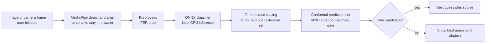

# AffectLens

**A local-first expression classifier that reports uncertainty and can abstain.**

## Demo

Run the local demo from the instructions below: <http://127.0.0.1:8000>. A public hosted demo is not configured in this workspace.

## Demo GIF

The browser flow supports image upload and opt-in live camera analysis. A recorded demo GIF is not included yet; no user camera footage is used in this repository.

## Architecture



## Results

All rows below use the same **4,078-image held-out FER+ split** and majority-vote class as the scoring target. The compact hard-label and soft-label runs use the full training split. EfficientNet-B0 is only a 1,000-image, four-epoch feasibility pilot; it is not a full-data comparison. Full per-class precision/recall/F1, confusion matrices, and risk-coverage data are in [`reports/model-comparison.json`](reports/model-comparison.json).

| Model | Test accuracy | Macro-F1 | ECE | Conformal coverage | Mean set size | Training note |
|---|---:|---:|---:|---:|---:|---|
| Compact, hard labels, light augmentation | 35.85% | 30.97% | 0.026 | 89.70% | 4.44 / 7 | Reference run |
| Compact, hard labels, no augmentation | 41.59% | 33.27% | 0.033 | 90.66% | 3.85 / 7 | Same split, seed, and epoch budget |
| Compact, FER+ soft labels | **44.14%** | **36.51%** | 0.034 | 90.73% | 4.22 / 7 | Active checkpoint; 10-rater distributions |
| ImageNet EfficientNet-B0 | 25.13% | 20.94% | **0.010** | 89.70% | 5.45 / 7 | 1,000 examples, four epochs, 48×48 pilot |

Temperature scaling is fit on a separate, stratified calibration partition; conformal quantiles are also fit there. The reported coverage is measured on the untouched test split. Shifted data do not inherit that coverage guarantee. The model usually cannot narrow its output to one class, so it displays a best guess while abstaining. This is an honest measure of current model weakness. In this run, removing augmentation improved the compact hard-label model; augmentation is not assumed to help without an ablation.

## Limitations

- FER-2013 is low-resolution and noisy. FER+ improves its labels but does not add new photographs.
- Evaluation is image-level, not identity-disjoint, and uses a single held-out split.
- Cross-dataset testing is **not run**: RAF-DB/AffectNet access has not been granted in this workspace.
- Subgroup fairness analysis is **not run**: the available data has no suitable demographic annotations. Do not infer fairness from aggregate scores.
- The EfficientNet-B0 result is a compute-limited pilot, not evidence that a pretrained backbone is worse when properly trained on a larger licensed dataset.
- Expression classes describe visible patterns; they do not establish internal feelings, intent, personality, or wellbeing. This demo is unsuitable for decisions about people.

AffectLens brings the FER-2013 seven-class task into one clean project, replacing machine-specific paths and training-on-import scripts with a reproducible trainer, a local API, and a browser interface. Its focus is **selective prediction**: a split-conformal calibration set can return a set of plausible classes or abstain when it cannot make a single-label prediction.

## What works in this foundation

- FastAPI service with a single-image analysis endpoint and a health endpoint.
- Browser interface with both image upload and opt-in live camera preview/analysis, showing all seven scores and conformal sets where available.
- Browser-local MediaPipe Face Landmarker detects faces, levels the eye line, and sends only the aligned crop to the local classifier.
- ONNX Runtime CPU inference, so a trained/exported model can run without a heavyweight training stack.
- Split-conformal prediction sets calibrated on data kept separate from training and checkpoint selection.
- FER data audit for class gaps, corrupt files, dimensions, and exact train/test duplicates.
- A metrics report with macro-F1, per-class scores, confusion matrix, calibration sample size, and test set coverage/abstention statistics.
- A controlled robustness benchmark for dim lighting, reduced contrast, blur, and occlusion.
- Streaming upload size/type checks. The service does not spool uploads or write images to disk.
- Local run by default; no account, external API, or cloud model is required.

The active checkpoint `artifacts/fer-ferplus.onnx` was trained on the FER+ crowd-annotated labels aligned with the 28,709 FER training images. FER+ uses ten ratings per image and provides a distribution across labels, which this trainer learns with soft-label cross entropy. On a deduplicated, stratified held-out portion of these images, it scored 44.14% accuracy and 36.51% macro-F1 against the majority class. The older hard-label checkpoint scored 31.35% / 27.39% on a different split and target labels; these figures are **not a controlled head-to-head comparison**. Neither is an official Kaggle test score or real-world accuracy. FER+ relabels the same photos; it does not add new photos. See [FER+ provenance and method](https://github.com/microsoft/FERPlus) and the included `data/raw/FERPlus-LICENSE.md`.

### Audit of the data currently in this workspace

The current [CSV-derived audit report](reports/fer-2013-train-csv-audit.json) shows seven classes, valid 48×48 images, no duplicate content crossing the generated splits, and no conflicting-label duplicates after those rows were excluded. The images were split at image level; FER-2013 has no reliable identity IDs, so this is not an identity-disjoint evaluation.

## Run locally

Requires Python 3.11 or newer and a modern browser. MediaPipe Face Landmarker runs in the browser using locally served WebAssembly and model assets; camera frames stay on the device until the aligned face crop is sent to the local API.

From the project directory, run:

```bash
python3 -m venv .venv
source .venv/bin/activate       # Windows: .venv\Scripts\activate
python -m pip install -e .
export AFFECTLENS_MODEL_PATH="$PWD/artifacts/fer-ferplus.onnx"
uvicorn affectlens.api:app --host 127.0.0.1 --port 8000
```

Open <http://127.0.0.1:8000>. Without a model, the interface and API are available but analysis returns a clear `503` message. API documentation is at <http://127.0.0.1:8000/docs>.

## Configure an ONNX model

Set `AFFECTLENS_MODEL_PATH` to a FER-compatible ONNX model. The expected input is one grayscale face crop normalized to `[-1, 1]`, with shape `N×1×H×W` (or `N×H×W×1`); output must be seven finite scores in this order:

`angry, disgust, fear, happy, neutral, sad, surprise`

Softmax probabilities or raw logits are accepted. The face crop is resized to 48×48 unless the ONNX model declares fixed spatial dimensions. Models with an adjacent `.uncertainty.json` sidecar use conformal prediction sets; otherwise the service uses a `0.55` score cutoff, adjustable with `AFFECTLENS_CONFIDENCE_THRESHOLD`. The score cutoff is **not a calibrated probability guarantee**.

```bash
AFFECTLENS_MODEL_PATH=/path/to/fer.onnx uvicorn affectlens.api:app --host 127.0.0.1 --port 8000
```

The browser uses the locally bundled MediaPipe Tasks Vision JavaScript runtime and `face_landmarker.task` model to detect, align, and crop one face. OpenCV Haar cascades remain a fallback when the browser runtime cannot load. Optional settings: `AFFECTLENS_FACE_CASCADE` points to a custom fallback cascade; `AFFECTLENS_MAX_UPLOAD_BYTES` changes the default 8 MiB limit. Dataset files stay under `data/` and are excluded from Git. Model weights and evaluation reports are local artifacts under `artifacts/` and are excluded from Git.

## Train the baseline

Install optional training dependencies and provide FER-style folders with one class folder per label. Both the original `disgusted` / `fearful` / `surprised` names and canonical class names are understood.

```bash
python -m pip install -e '.[train]'
python -m affectlens.train --data data/fer-2013 --output artifacts/fer.onnx --epochs 30
AFFECTLENS_MODEL_PATH="$PWD/artifacts/fer.onnx" uvicorn affectlens.api:app --host 127.0.0.1 --port 8000
```

The trainer makes stratified fit, checkpoint-selection, and conformal-calibration splits. If `validation/` is present, it is reserved for checkpoint selection and 15% of unique `train/` image groups are reserved for calibration. Otherwise, `train/` is split 70/15/15. It selects a checkpoint by macro-F1 on the selection split, calculates a split-conformal quantile from the untouched calibration split, and evaluates once on `test/`. It exports the ONNX model, an `.uncertainty.json` sidecar, and a `.metrics.json` report. At inference, a singleton set yields a class label; an empty or multi-class set yields an abstention. The target marginal coverage is 90% when calibration and inference examples are exchangeable and use the same preprocessing. The training benchmark uses pre-cropped FER faces, while the app detects and crops faces from uploaded images; therefore its coverage claim does **not** automatically transfer to arbitrary webcam photos. Distribution shift can invalidate the guarantee. Before training, the trainer rejects missing classes, unreadable images, cross-split duplicates, conflicting labels, and repeated validation/test samples. Exact duplicates within training are grouped into the same split. FER-2013 has no reliable identity grouping, so these image-level splits still do not ensure identity-disjoint evaluation.

The calibrated set uses nonconformity score `1 - p(true class)`. Its quantile is selected at finite-sample rank `ceil((n + 1) × (1 - alpha))` on the separate calibration split. This is a standard conformal prediction method, not a claim of a new algorithm. The engineering contribution is an end-to-end pipeline that carries uncertainty through training, ONNX deployment, API responses, and the UI, while surfacing its assumptions.

Before training on any dataset, run the data audit to inspect class coverage, corrupt images, dimensions, and exact duplicate content across splits:

```bash
python -m affectlens.audit_data --data data/fer-2013 --output reports/fer-2013-audit.json
python -m affectlens.evaluate_robustness --data data/fer-2013 --model artifacts/fer.onnx --output reports/robustness.json
```

## Rebuild the dataset from the original CSV

For the original three-way benchmark, obtain `fer2013.csv` from the [official Kaggle competition data page](https://www.kaggle.com/c/challenges-in-representation-learning-facial-expression-recognition-challenge/data) using an account that has accepted its terms. The converter preserves `Training`, `PublicTest`, and `PrivateTest` as `train/`, `validation/`, and `test/` respectively. For a labeled training-only CSV with `emotion,pixels` columns, pass `--train-only-split`; this creates a stratified 70/15/15 holdout and must not be described as an official test result.

```bash
python -m affectlens.convert_fer_csv --csv /path/to/fer2013.csv --output data/fer-2013-complete
python -m affectlens.audit_data --data data/fer-2013-complete --output reports/fer-2013-complete-audit.json
python -m affectlens.train --data data/fer-2013-complete --output artifacts/fer.onnx --epochs 30
```

For the FER+ crowd annotations used by the active checkpoint, create soft-label splits with:

```bash
python -m affectlens.convert_ferplus --csv data/raw/fer2013_train.csv --ferplus data/raw/fer2013new.csv --output data/fer-2013-ferplus --seed 42
python -m affectlens.audit_data --data data/fer-2013-ferplus --output reports/fer-2013-ferplus-audit.json
python -m affectlens.train --data data/fer-2013-ferplus --output artifacts/fer-ferplus.onnx --epochs 30 --patience 6
```

The converter skips images with no emotion votes or low agreement/non-face votes, deduplicates identical pixel content, averages annotator distributions across duplicates, and writes a reproducible image-level 70/15/15 split. The current run used 27,190 unique images. FER+ labels have disagreement; metrics here use the most-voted class for conventional accuracy and macro-F1.

For a hard-label training-only CSV, create the image-level holdout with:

```bash
python -m affectlens.convert_fer_csv --csv data/raw/fer2013_train.csv --output data/fer-2013-from-train-csv --train-only-split --seed 42
python -m affectlens.audit_data --data data/fer-2013-from-train-csv --output reports/fer-2013-train-csv-audit.json
python -m affectlens.train --data data/fer-2013-from-train-csv --output artifacts/fer.onnx --epochs 30
```

## Evaluation before making claims

Use a held-out test set that was not used for training, calibration, or model selection. Report macro-F1, per-class recall, confusion matrix, conformal coverage, singleton coverage, and singleton accuracy. Repeat evaluation across controlled lighting, blur, occlusion, and acquisition-device shifts, and across demographic slices only where consent and metadata permit. FER-2013 is a small, noisy benchmark and should not be treated as a proxy for real-world performance. Keep dataset licenses, provenance, and consent records with any data you add.

## Scope and limits

This classifies patterns in a face image. Facial expression labels do not establish a person's internal emotional state, intent, personality, or wellbeing. AffectLens is for voluntary experimentation and model evaluation, not hiring, education, healthcare, policing, or other decisions about people. Camera access starts only after the user clicks **Start camera**; audio is disabled. MediaPipe detects and aligns each frame in the browser; individual face crops go to the local API. The app does not record video or store requests. Stop camera to end the browser camera stream.

## Structure

```text
affectlens/  API, inference, training, data audit, robustness evaluation, and browser UI
data/        local datasets (excluded from Git)
artifacts/   generated models and reports (excluded from Git)
```

## Next engineering milestones

1. Obtain permission for a distinct, licensed expression dataset and evaluate cross-dataset generalization; additional FER+ labels are not additional photos.
2. Add end-to-end detector evaluation and report accuracy/abstention across lighting, pose, occlusion, and camera conditions.
3. Add model/data cards, CI, latency and model-size measurements, and a quantized edge build after cross-dataset validation.

An interview project is strongest when the measurements and limitations are real. Start with a baseline, publish a reproducible evaluation, and demonstrate one measurable improvement such as better selective risk or robustness to controlled lighting changes.
